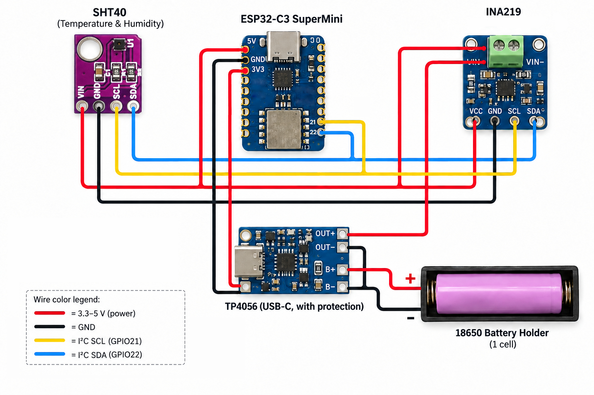
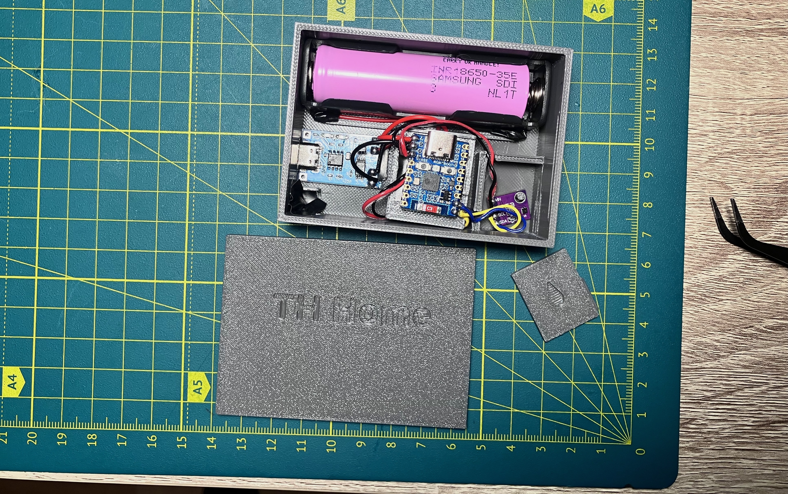
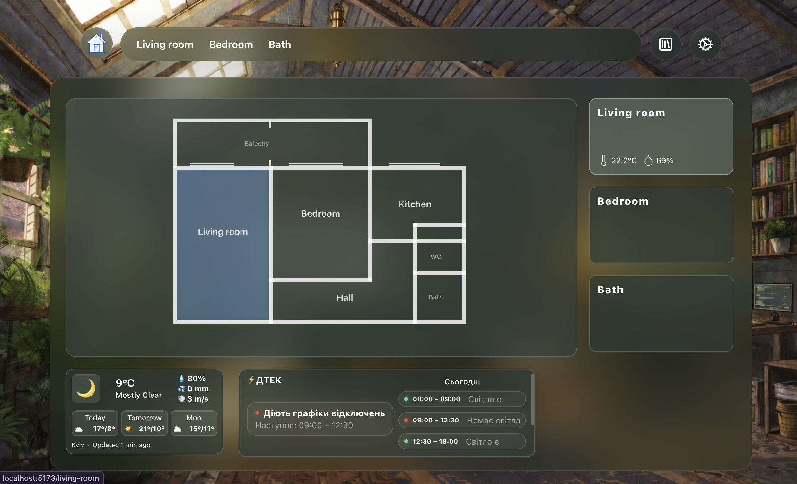
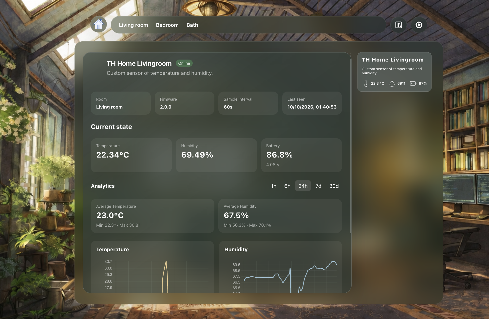
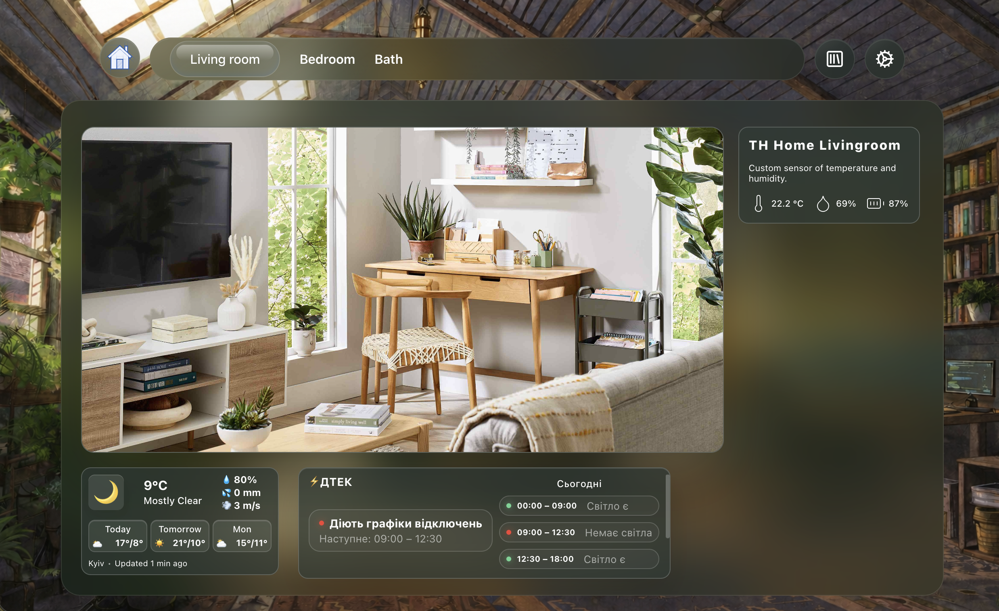
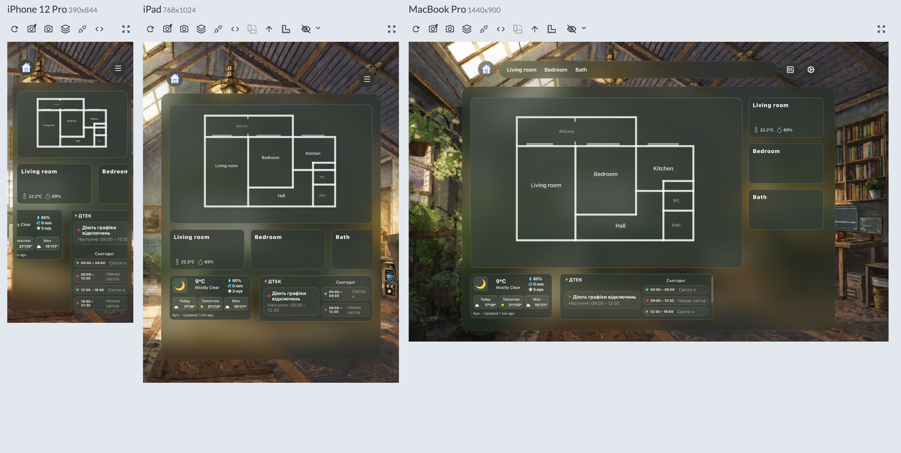

# Sheva - Home Monitoring System

<table>
  <tr>
    <td width="50%" valign="top">
Локальна IoT-система для моніторингу температури/вологості у кімнатах і візуалізація даних з інтеграцій погоди та графіків відключень. 

#### Проєкт складається з: #### 
- датчики температури/вологості
- Node.js сервер + SQLite бд
- React/TS веб дашборд

<hr/>  

> **Статус:** In active development  
> **Останнє оновлення доків:** 09.10.2026  
> **Версія прошивки:** 0.2.0

<hr/>

</td>
    <td width="50%">


    </td>
  </tr>
</table>

## Можливості


<table>
  <tr>
    <td width="50%" valign="top">
        
### Моніторинг середовища

<p>На основі кортролера ESP32 і SHT40 реалізований датчик, що передає заміри температури повітря та вологості на сервер у локальній Wi-Fi мережі. Корпус реалізований за допомогою 3д друку. Модель - <a href="/docs/assets/box_THhome.3mf">box_THhome.3mf</a> </p>
<p>Основні функції:</p>
<ul>
    <li>Вимірювання температури та вологості повітря</li>
    <li>Передавання показників через Wi-Fi</li>
    <li>Моніторинг напруги та орієнтовного рівня заряду акумулятора</li>
    <li>Визначення активності пристрою</li>
    <li>Збереження історії вимірювань</li>
    <li>Візуалізація статистики та графіків</li>
</ul>


</td>
    <td width="50%">




    </td>
  </tr>
</table>


<table>
  <tr>
    <td width="30%" valign="top">

### Інтерактивний дашборд ###

<ul>
    <li>План квартири з інтерактивними кімнатами</li>
    <li>Картки з актуальними інтекраціями</li>
    <li>Окремі сторінки кімнат</li>
    <li>Перегляд підключених пристроїв</li>
    <li>Детальна інформація про датчики з графіками по отриманим данним</li>
</ul>

</td>
    <td width="30%">




</td>
    <td width="30%">



    </td>
  </tr>
</table>


### Зовнішні інтеграції

**Yasno — графіки відключень електроенергії**

- Визначення групи відключень за адресою.
- Розклад на сьогодні та завтра.
- Інформація про наступне відключення або відновлення електропостачання.

**УкрГідрометЦентр — погодні дані**

- Поточна температура та погодні умови.
- Вологість, тиск, вітер та опади.
- Прогноз погоди до 10 днів залежно від доступності даних.


## Архітектура

```text
                   ┌──────────────────┐
                   │     Датчик       │
                   │    ESP32-C6      │
                   │  SHT40 / INA219  |
                   |     / TP5046     │
                   └────────┬─────────┘
                            │
                         Wi-Fi
                            │
                            ▼
                   ┌──────────────────┐  HTTP   ┌──────────────────┐ 
                   │   Backend API    │◀––––––––│    React SPA     │
                   │ Node.js / Fastify│         │   Веб-дашборд    │
                   └───────┬──────────┘         └──────────────────┘
                           │
                ┌──────────┼──────────┐
                ▼          ▼          ▼
          ┌─────────┐ ┌────────┐ ┌───────────┐
          │ SQLite  │ │ Yasno  │ │  УкрГМЦ   │
          │         │ │  API   │ │    API    │
          └─────────┘ └────────┘ └───────────┘

```

Датчики передають дані на локальний сервер. Сервер перевіряє та зберігає вимірювання, формує аналітику й надає API для вебклієнта. Дані зовнішніх сервісів отримуються сервером окремо. Для Yasno та погодної інтеграції потрібне підключення до Інтернету.

## Технології

| Компонент | Технології |
|---|---|
| Мікроконтролер | ESP32-C6-Zero |
| Прошивка | C++, Arduino, PlatformIO |
| Датчики | SHT40, INA219 |
| Backend | Node.js, TypeScript, Fastify |
| Валідація API | TypeBox |
| База даних | SQLite, Drizzle ORM |
| Frontend | React, TypeScript, Vite |
| Маршрутизація | React Router |
| Графіки | Chart.js |
| Іконки | Lucide React |

## Структура репозиторію

```text
sheva/
├── client/                # Вебінтерфейс React
│   └── src/
│       ├── assets/        # Статичні ресурси
│       ├── entities/      # Типи сутностей
│       ├── features/      # Функціональні компоненти
│       ├── pages/         # Сторінки
│       └── shared/
│           ├── api/       # HTTP-запити
│           ├── hooks/     # React-хуки
│           └── lib/       # Допоміжні функції
│
├── server/                # Backend API
│   ├── drizzle/           # Міграції БД
│   └── src/
│       ├── config/        # Конфігурація
│       ├── db/            # SQLite та Drizzle
│       ├── routes/        # API endpoints
│       └── services/
│           └── integrations/
│
├── firmware/
│   └── esp32/             # Прошивка ESP32
│       ├── include/
│       ├── lib/
│       └── src/
│           └── main.cpp
│
└── docs/
    ├── architecture.md    # Архітектура системи
    └── database.md        # Структура бази даних
```

## Апаратна частина

Перша реалізована версія датчика призначена для моніторингу температури та вологості. Модель для 3д друку корпусу <a href="/docs/assets/box_THhome.3mf">box_THhome.3mf</a>.
SHT40 у корпусі ізольований, щоб уникнути похибки при нагріванні акумулятора, контролера. В корпусі була передбачена кнопка живлення але фіксуючі елементи виявились непридатними. Корпус потребує допрацювання. 


**Компоненти:**
- ESP32-C6-Zero
- SHT40
- INA219
- Li-ion 18650
- TP4056


### Принцип роботи

1. ESP32 ініціалізує датчики.
2. Перевіряє напругу акумулятора.
3. Зчитує температуру та вологість.
4. Підключається до Wi-Fi.
5. Надсилає вимірювання на сервер через HTTP.
6. Вимикає Wi-Fi та переходить у режим очікування або глибокого сну.
7. Повторює цикл.

Звичайний інтервал передавання — 60 секунд.

Прошивка також реалізує захист від низької напруги: при падінні до 3,35 В припиняє передавання даних і переходить на п'ятихвилинний інтервал перевірки. Відновлення роботи відбувається після досягнення 3,65 В.

### Приклад вимірювання

```json
{
  "schemaVersion": 1,
  "messageId": "unique-message-id",
  "temperatureC": 24.5,
  "humidityPct": 52.8,
  "batteryVoltage": 3.91,
  "batteryPct": 61.5,
  "rssiDbm": -57,
  "firmwareVersion": "2.0.0"
}
```
### Вимоги

Для локального запуску потрібні:

- Node.js та npm.
- Git.
- Доступ до локальної мережі.
- PlatformIO — для роботи з прошивкою.
- SQLite CLI — необов'язково, для ручної роботи з БД.

### 1. Клонування

```bash
git clone https://github.com/Polkan37/sheva.git
cd sheva
```

### 2. Backend

Встановлення залежностей:

```bash
cd server
npm install
```

Створіть `.env` на основі `.env.example`.

Мінімальна конфігурація:

```env
DB_FILE_NAME=./data/dbName.db
```

Для інтеграції Yasno:

```env
YASNO_REGION_ID=
YASNO_DSO_ID=
YASNO_STREET=
YASNO_HOUSE=
```

Для погодної інтеграції:

```env
LOCATION=
LATITUDE=
LONGITUDE=
```

Створіть каталог для бази даних, якщо він відсутній:

```bash
mkdir -p data
```

Запуск у режимі розробки:

```bash
npm run dev
```

Сервер доступний за адресою:

```text
http://localhost:3000
```

Перевірка доступності:

```http
GET http://localhost:3000/health
```

Очікувана відповідь:

```json
{
  "status": "ok"
}
```

### 3. Frontend

В окремому терміналі:

```bash
cd client
npm install
npm run dev
```

Відкрийте адресу, яку виведе Vite (зазвичай `http://localhost:5173`).

Для доступу до API необхідно налаштувати відповідний HTTP origin або proxy.

У поточній реалізації частина API-модулів використовує відносні шляхи `/api/...`, а спільний клієнт підтримує `VITE_API_URL`.

Приклад конфігурації:

```env
VITE_API_URL=http://localhost:3000
```

Самого встановлення цієї змінної недостатньо для модулів, які звертаються до відносного `/api/`. Для них потрібен proxy або узгоджене використання спільного API-клієнта.

### 4. Прошивка ESP32

Перейдіть у каталог:

```bash
cd firmware/esp32
```

Створіть `include/secrets.h` на основі `include/secrets.example.h` та задайте параметри Wi-Fi і сервера.

Параметр `API_BASE_URL` повинен вказувати на адресу backend-сервера, доступну з ESP32.

Наприклад:

```text
http://127.0.0.1:3000
```

Прошивка:

```bash
pio run -t upload
```

Serial Monitor:

```bash
pio device monitor -b 115200
```
Список підключених пристроїв:

```bash
pio device list
```


## API

Основні доступні endpoints:

| Метод | Endpoint | Призначення |
|---|---|---|
| GET | `/health` | Стан сервера |
| GET | `/api/rooms` | Перелік кімнат |
| GET | `/api/devices/` | Перелік пристроїв |
| POST | `/api/devices/:uid/measurements` | Приймання вимірювань |
| GET | `/api/devices/:uid/measurements` | Історія вимірювань |
| GET | `/api/devices/:uid/analytics` | Агрегована статистика |
| GET | `/api/integrations` | Зовнішні інтеграції |


## Поточні обмеження

- Реалізований один тип фізичного датчика.
- Реєстрація пристроїв поки не має окремого API.
- Не реалізована автентифікація пристроїв.
- Відсутній механізм OTA-оновлення прошивки.
- Зовнішні інтеграції залежать від доступності API провайдерів.
- Дані інтеграцій не кешуються в постійному сховищі.
- Немає централізованого механізму оновлення даних у реальному часі.
- Історія міграцій бази даних потребує узгодження.
- Немає завершеної системи автоматизованого тестування та розгортання.

Проєкт призначений насамперед для локальної мережі. Публічне розгортання потребує додаткових заходів безпеки.

## Плани розвитку

- Виправити та перевірити міграції SQLite.
- Додати автентифікацію IoT-пристроїв.
- Реалізувати керування пристроями через інтерфейс.
- Додати централізоване оновлення даних.
- Покращити обробку помилок і кешування інтеграцій.
- Реалізувати автоматизовані тести.
- Підключити ecoflow, aeno, dreamy.
- Розгорнути сервер на Raspberry Pi.


## Документація

Детальна технічна інформація:

- [Архітектура системи](docs/architecture.md)
- [Структура бази даних](docs/database.md)

## Ліцензія

Проєкт містить файл [LICENSE](LICENSE). Умови використання визначаються його вмістом.

---

**SHEVA** — персональний IoT-проєкт, спрямований на створення модульної системи домашнього моніторингу з власними пристроями та інтеграціями.
